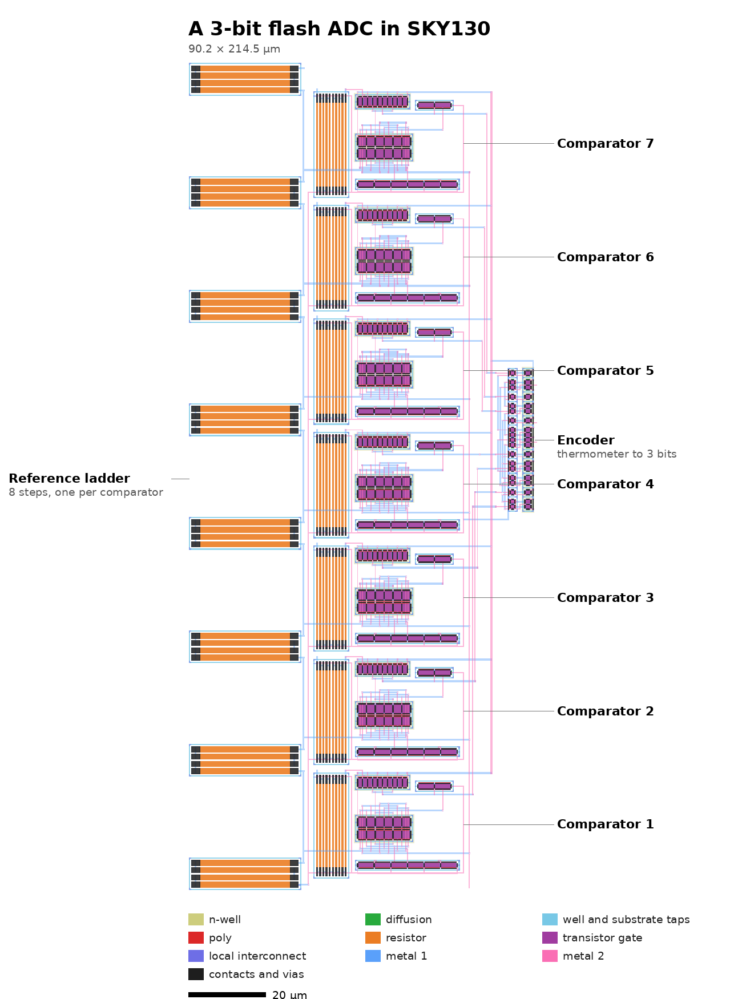
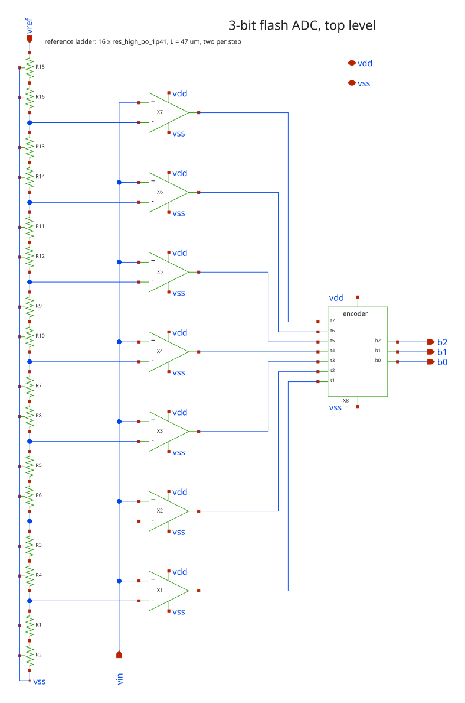
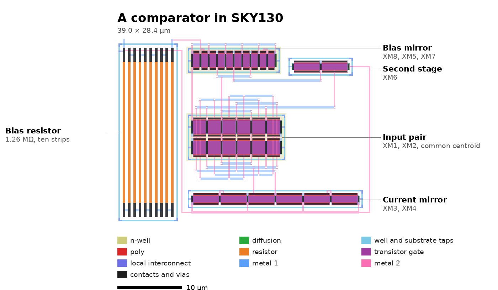

# sky130-flash-adc-layout

The layout of a continuous-time comparator in the SkyWater SKY130 open PDK, and of the 3-bit
flash ADC it is part of, from the schematic to the post-layout simulation: DRC, LVS, parasitic
extraction and a comparison of the pre-layout and post-layout performance in three process
corners.

**Status:** laid out and verified. The comparator ([mag/comparator.mag](mag/comparator.mag))
and the whole ADC ([mag/adc.mag](mag/adc.mag), [gds/adc.gds](gds/adc.gds)): seven comparators,
the reference ladder and the encoder, 90 × 215 µm. Both pass DRC and LVS against the schematic.
After layout the comparator behaves as designed in DC and is 22 to 41 % slower, and the ADC's
transfer curve has no missing codes and its thresholds in place in every corner.



Layout by **Mauro Rodriguez Blasco**. The circuit was designed in
[VibeSPICE](https://github.com/mauro-hw/vibespice), an agent by the same author that designs
and simulates analog circuits, with Claude Code (Anthropic) as its agent, and reviewed with
Claude.

## The circuit

One of the seven comparators of a 3-bit flash ADC: 1.8 V supply, input range 0 to 0.9 V, so
`inn` sits at one of the taps 0.1125 to 0.7875 V. The output goes high when `inp` is above
`inn`.

- **First stage:** a low-Vt PMOS input pair, so that it works from the lowest tap up, with
  an NMOS current-mirror load.
- **Second stage:** an NMOS common-source stage that gives a full logic level.
- **Bias:** about 1 µA from four equal high-resistivity poly segments (1.26 MΩ) and a diode
  PMOS. The tail carries 2 µA and the second stage 1 µA.

Pre-layout netlist, the reference for LVS: [netlist/comparator.spice](netlist/comparator.spice).
It includes the layout's eight dummies, switched off.

| Device | Role | Type | Unit W × L (µm) | Units | Gate area |
|---|---|---|---|---|---|
| XM1, XM2 | input pair | pfet_01v8_lvt | 2 × 2 | 4 each | 16 µm² each |
| XM3, XM4 | mirror load | nfet_01v8_lvt | 1 × 4 | 2 each | 8 µm² each |
| XM6 | second stage | nfet_01v8_lvt | 1 × 4 | 2 | 8 µm² |
| XM8, XM5, XM7 | bias diode, tail, second-stage load | pfet_01v8_lvt | 2 × 1 | 2, 4, 2 | 4, 8, 4 µm² |
| XR1–XR4 | bias resistor | res_xhigh_po_0p35 | 0.35 × 55 | 4 in series | 1.26 MΩ |

Every transistor is a unit repeated `m` times with `mult` equal to `m`, so that the PDK's
mismatch averages over the fingers as it would on silicon. All the transistors are low-Vt.

The ADC around it: a ladder of 16 high-resistivity poly resistors from `vref` (0.9 V) to `vss`
sets the 7 thresholds on the comparators' `inn`, `vin` goes to every `inp`, and an encoder turns
their thermometer code into `b2 b1 b0`. The top-level schematic, [xschem/adc.sch](xschem/adc.sch),
matches [netlist/adc.spice](netlist/adc.spice) in Netgen (`python3 scripts/flow.py sch adc`):



## Requirements

They come from the ADC. With random comparator offsets, a Monte Carlo of the ADC (no missing
codes; DNL, INL, offset and gain error within ±0.5 LSB) shows that 99.9 % of ADCs work when
the comparators' offset has a standard deviation of about 10 mV or less. The comparator aims
at **σ ≤ 8 mV** in every corner, which leaves room for the ladder and the reference. It must
also work over the whole input range at 1.60 V.

## Pre-layout results

`python3 scripts/sim.py`: 112 copies with the PDK's mismatch models, 16 at each tap, and the
nominal circuit, in the three sign-off corners. The delay is the slowest tap's, from `inp`
crossing the tap to `out` crossing half the supply, with `inp` stepping 10 mV either side.

| | tt, 25 °C, 1.80 V | ss, 100 °C, 1.60 V | ff, −40 °C, 1.95 V |
|---|---|---|---|
| Offset σ, with mismatch | 5.36 mV | 5.37 mV | 5.32 mV |
| Offset mean; min / max | −0.14; −12.3 / +13.6 mV | −0.14; −12.3 / +13.8 mV | −0.12; −12.4 / +13.4 mV |
| Offset without mismatch, worst tap | −0.13 mV | −0.19 mV | +0.10 mV |
| Supply current, largest | 4.55 µA | 4.31 µA | 4.63 µA |
| Output high / low | 1.800 V / 39 mV | 1.600 V / 75 mV | 1.950 V / 21 mV |
| Delay, `out` rising / falling | 204 / 106 ns | 212 / 122 ns | 194 / 95 ns |
| Tail at the top tap, V<sub>SD</sub> / current | 0.41 V / 2.01 µA | 0.28 V / 1.87 µA | 0.52 V / 2.03 µA |

The σ of 112 copies is itself uncertain: on the same netlist, other random draws give between
5.06 and 5.89 mV. Without the dummies, this draw gave 5.18 mV.

In VibeSPICE, the whole ADC with seven of these comparators and one mismatch sample has no
missing codes, a DNL of 0.19 LSB and an INL of 0.15 LSB in every corner.

## Post-layout results

`python3 scripts/sim.py build/comparator_pex.spice`: the same benches on the netlist extracted
from the layout, with every finger as a device of its own, its drawn junctions and 42 wiring
capacitances.

| | tt, 25 °C, 1.80 V | ss, 100 °C, 1.60 V | ff, −40 °C, 1.95 V |
|---|---|---|---|
| Offset σ, with mismatch | 4.91 mV | 4.90 mV | 4.91 mV |
| Offset mean; min / max | −0.21; −11.1 / +15.6 mV | −0.26; −11.1 / +15.3 mV | −0.18; −11.1 / +15.7 mV |
| Offset without mismatch, worst tap | −0.13 mV | −0.19 mV | +0.11 mV |
| Supply current, largest | 4.54 µA | 4.29 µA | 4.62 µA |
| Output high / low | 1.800 V / 39 mV | 1.600 V / 75 mV | 1.950 V / 21 mV |
| Delay, `out` rising / falling | 254 / 149 ns | 268 / 172 ns | 237 / 131 ns |

- **In DC the layout changes practically nothing:** the offset without mismatch and the output
  levels are the same, the current is 0.3 % lower (the folded resistor's extra contacts), and σ
  stays within the uncertainty of its estimate, far below 8 mV.
- **It costs speed:** 22 to 26 % with `out` rising and 38 to 41 % falling. In tt the drawn
  junctions add 5 ns; the rest is the wiring, mostly on `OUT1`, which carries 11.5 fF next to
  the 40 fF of XM6's gate. The ADC has no speed requirement yet.

## The ADC, after layout

`python3 scripts/adc_sim.py build/adc_pex.spice`: `vin` swept from 0 to 0.9 V in 1 mV steps,
`vref` an ideal 0.9 V, on the netlist extracted from the whole ADC, without mismatch.

| | tt, 25 °C, 1.80 V | ss, 100 °C, 1.60 V | ff, −40 °C, 1.95 V |
|---|---|---|---|
| Missing codes | 0 | 0 | 0 |
| Monotonic | yes | yes | yes |
| Thresholds (mV) | 113 225 338 450 563 675 788 | 113 225 338 450 563 675 788 | 113 225 338 450 563 675 788 |
| Largest DNL / INL | < 0.01 LSB | < 0.01 LSB | < 0.01 LSB |

The same as the schematic (`python3 scripts/adc_sim.py`), down to the 1 mV of the sweep
(0.009 LSB). With mismatch, what moves the thresholds is the comparators' offset, σ ≈ 5 mV or
0.04 LSB, and the ladder's, 0.4 mV.

## How the design got here

1. **A first version met its offset nominally but not with mismatch.** Its input pair
   (4 × 0.5 µm) and mirror (1 × 1 µm) gave an offset with a 20 mV standard deviation. No
   layout technique fixes random mismatch: only device area does (Pelgrom).
2. **The requirement was set from the ADC's yield**, not from a fixed offset. The ADC's
   gain-error limit was relaxed to ±0.5 LSB, like the others; at ±2 % it alone would have
   asked for σ ≤ 3.5 mV.
3. **VibeSPICE redesigned the comparator** with a regular-Vt input pair, at a reported
   σ = 5.7 mV.
4. **A review found two problems:**
   - **Overstated mismatch.** The transistors used `m=` without `mult=`. SKY130's mismatch
     scales with 1/√(W·L·mult), so the m fingers varied as one. With `mult=` equal to `m=`,
     σ was 3.6 mV.
   - **No headroom at the top tap.** The regular-Vt pair needed so much V<sub>SG</sub> that
     at a 0.79 V input the tail source had 9 mV across it in ss. Its current fell from 2 µA
     to 0.18 µA.

   A low-Vt pair fixes the second and keeps σ at 5.2 mV.

Every problem met on the way, its cause and its fix: [docs/diary.md](docs/diary.md).

## Layout



Each block is a cell of `mag/` with its own LVS reference in `netlist/`; why each one is drawn
as it is, with the numbers, is in [docs/diary.md](docs/diary.md).

- **Input pair (`pair`):** 8 units in a 2 × 4 common centroid, rows D A B B A D / D B A A B D,
  in one n-well with an n+ guard ring. The dummies' gates go to vdd, and each drain carries two
  of them.
- **Mirror load (`mirror`):** one row, D B A A B D, with a p+ guard ring; the dummies touch the
  diode's node.
- **Second stage (`stage2`):** XM6 alone, two fingers with `out` on the shared middle column.
  Its errors reach the input divided by the first stage's gain, so it needs no centroid.
- **Bias mirror (`bias`):** one row, D 8 5 5 7 7 5 5 8 D: `out` on one shared column, the
  dummies on VBIAS.
- **Bias resistor (`rbias`):** the netlist's four segments of 55 µm drawn as ten strips of 22 µm
  in series, as a serpentine, so that it is as tall as the rest of the comparator (Netgen adds
  the lengths of resistors in series; the extra contacts add 0.3 % to its value). No dummies:
  its value sets the currents, not the offset.
- **Reference ladder (`ladder`), the ADC's:** a column of 8 steps (`lstep`), one beside each
  comparator, so that each tap meets its comparator's `inn`. Each step is the netlist's two
  strips of 47 µm drawn as four of 23.5 µm in series, lying down with both its ends facing the
  comparators. No dummies: for 3 bits its matching hardly matters (200 ladders with the PDK's
  mismatch give at worst 0.011 LSB of DNL and 0.018 LSB of INL).
- **Encoder (`encoder`), the ADC's:** 11 gates (inverters, NAND2, NAND4; 38 transistors,
  L = 1 µm) drawn like standard cells, PMOS over NMOS with the rings' sides as the `vdd` and
  `vss` rails, side by side in one row of 37 × 10.5 µm. The parallel PMOS of each NAND share
  the output column (`vdd | y | vdd`); the nets between gates run on 4 tracks under the row.
  The extracted encoder gives the 8 codes right in the three corners.
- **Top cell (`comparator`):** 39.0 × 28.4 µm. `bias` and `stage2` side by side on top, so that
  `out` stays short and away from the inputs; `pair` below them and `mirror` at the bottom, so
  that `TAIL`, `OUT1` and `XM2_drain` are short; the resistor on the left, rotated so that its
  `VBIAS` end is next to the bias mirror. Folding the resistor into ten strips took the cell
  from 34 × 61 µm to this, 47 % less area.
- **ADC (`adc`):** 90 × 215 µm. The seven comparators in one column, in the ladder's order;
  the ladder on the left, each tap straight onto its comparator's `inn` bus; on the right a
  `vin` spine to every `inp`, each output on its own spine to the encoder's input, and a `vdd`
  spine; a `vss` spine on the left. All in metal1 and metal2: each comparator's `inn`, `inp`,
  output and `vdd` buses extend out of it without crossing anything.
- **Routing inside the comparator, as extracted:**
  - `OUT1` and `XM2_drain`: short, with nearly equal couplings to the inputs (`inp`–`OUT1`
    1.76 fF, `inn`–`XM2_drain` 1.73 fF).
  - `TAIL`: one short wire from the bias mirror straight down to the pair's tail bus.
  - `out`, which swings rail to rail: 0.06 fF to `inn` and practically nothing to `inp`.
  - `VBIAS` (about 1 MΩ): short, on the far side from `out`; 0.32 fF between them, inside the
    bias mirror.

## The flow

The layout cells live in `mag/`; start Magic there (`cd mag && magic`) and it reads
[mag/.magicrc](mag/.magicrc). The checks run without a window:

```bash
python3 scripts/flow.py selftest          # the tools, on a transistor Magic generates
python3 scripts/flow.py all comparator    # DRC, LVS against netlist/comparator.spice, PEX, GDS
python3 scripts/sim.py build/comparator_pex.spice    # the same tables, after layout
python3 scripts/flow.py sch adc           # the schematic xschem/adc.sch against netlist/adc.spice
python3 scripts/flow.py all adc           # the whole ADC, against netlist/adc.spice
python3 scripts/adc_sim.py build/adc_pex.spice       # its transfer curve, after layout
python3 scripts/render.py adc             # docs/images/adc.png (needs Pillow)
```

| Step | Tool |
|---|---|
| Schematic | xschem 3.1.0 |
| Simulation | ngspice 47 |
| Layout, DRC and parasitic extraction | Magic 8.3.685 (Fedora 44, on Tcl 9) |
| LVS | Netgen 1.5.326, built from source |
| PDK | sky130A, open_pdks `c6d73a35f524070e85faff4a6a9eef49553ebc2b`, installed with volare |

Three traps of this setup:
- Fedora 44's Magic runs on Tcl 9. Both this open_pdks's device generators and Magic's own
  device dialog name variables in a way that Tcl 9 no longer resolves, so every generated
  device fails. `mag/.magicrc` fixes both at startup.
- Fedora's `netgen` package is version 1.3.7, from 2005, with no `lvs` command. Netgen 1.5 is
  built from [its source](https://github.com/RTimothyEdwards/netgen) into `~/.local`.
- GCC 16 compiles C23 by default, and one of Netgen's files does not build under it. The fix
  is `make EXTRA_CFLAGS=-std=gnu99`.

## License

[Apache License 2.0](LICENSE). If you reuse or adapt this design, keep the [NOTICE](NOTICE)
file with it.
